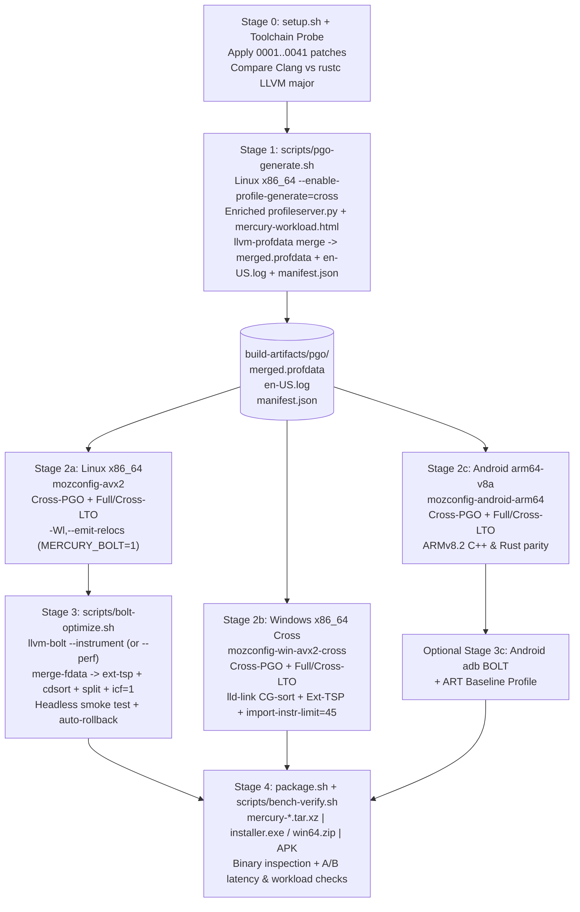

# Mercury Build, Toolchain & Binary Speed Pipeline (Approach A)

**Date:** 2026-11-23  
**Base:** Firefox 160.0.1 (`$HOME/mozilla-unified`)  
**Targets:** Linux `x86_64` (native), Windows `x86_64` (Linux cross-compile & native), Android `arm64-v8a` (Linux cross-compile)  
**Status:** Implemented

---

## 1. Goals, Compatibility Floor & Non-Goals

### Goals
1. **Profile-Once Cross-PGO across all 3 platforms:** Generate one enriched LLVM IR profile (`merged.profdata` + `en-US.log`) on native Linux `x86_64` and reuse it via Firefox 160's native `--enable-profile-use=cross` + `--with-pgo-profile-path` across Linux, Windows cross-compile, and Android `arm64-v8a` builds.
2. **True Full / Cross-Language LTO:** Eliminate the silent ThinLTO fallback in `build/moz.configure/lto-pgo.configure` (which downgrades plain `--enable-lto` to `-flto=thin` whenever `MOZ_AUTOMATION` is unset). Default to `--enable-lto=cross,full` when the active Clang and `rustc` share the same LLVM major version (e.g., Firefox 160 bootstrapped Clang 22.1.8 + `rustc` LLVM 22.1.4), with deterministic fallback to `--enable-lto=full`.
3. **Post-Link Binary Layout Optimization (BOLT):** Add a safe, reproducible `llvm-bolt` pass for Linux `libxul.so` (and optional Android `libxul.so` via `adb`) using **BOLT instrumentation mode by default** (no `perf`, no hardware LBR, and no root privileges required), with optional `--perf` LBR mode, automatic post-BOLT headless smoke-testing, and guaranteed rollback on any error.
4. **Fast Developer Iteration Toggle:** Provide `--fast` / `MERCURY_FAST_BUILD=1` across all mozconfigs and orchestrator scripts to disable PGO, LTO, BOLT, and `geckodriver`, use `-O2`, and raise Rust `codegen-units=16`.
5. **Lean Release Builds:** Drop `--enable-clang-plugin` (compile-time static analysis with zero runtime gain) from all release mozconfigs and strip verified unused components (`--disable-default-browser-agent`, `--disable-backgroundtasks`, `--disable-dmd`, `--disable-necko-wifi` where supported).

### Compatibility Floor
| Platform | Target Triple | C/C++ ISA Floor | Rust Target Floor |
| --- | --- | --- | --- |
| Linux (primary) | `x86_64-pc-linux-gnu` | `-march=x86-64-v3` (AVX2, BMI1/2, FMA, F16C, LZCNT, MOVBE) | `-C target-cpu=x86-64-v3 -C target-feature=+avx2` |
| Windows (primary) | `x86_64-pc-windows-msvc` | `-march=x86-64-v3 -arch:AVX2` (`clang-cl`) + `-mllvm:-mcpu=x86-64-v3` | `-C target-cpu=x86-64-v3 -C target-feature=+avx2` |
| Android (primary) | `aarch64-linux-android` | `-march=armv8.2-a+fp16+rcpc+dotprod+crypto -mtune=cortex-a76` | `-C target-cpu=cortex-a76 -C target-feature=+fp16,+rcpc,+dotprod,+crypto` |

Legacy Linux/Windows tiers (`mozconfig`, `mozconfig-sse3`, `mozconfig-sse4`, `mozconfig-win`, `mozconfig-win-sse3`, `mozconfig-win-sse4`, `mozconfig-arm64`, `mozconfig-android-x86_64`, macOS mozconfigs) retain their respective ISA floors while inheriting the same env-driven `MERCURY_FAST_BUILD`, `MERCURY_PGO_PROFILE`, `MERCURY_LTO_MODE`, and `--enable-clang-plugin` removal upgrades.

### Non-Goals
- Native Windows BOLT (LLVM BOLT does not support PE/COFF binaries; Windows relies on Cross-PGO + Full/Cross-LTO + `lld-link` call-graph profile sorting + Ext-TSP block placement).
- Requiring root privileges or kernel `perf_event_paranoid` changes for standard Linux release builds.
- Modifying upstream Firefox PGO/LTO core semantics when explicit mozconfig flags already achieve the exact behavior cleanly.

---

## 2. Architecture & Data Flow



### Why Profile-Once Cross-PGO Works Across All 3 Platforms
LLVM's IR-level PGO (`-fprofile-generate` / `-fprofile-use` for Clang, `-C profile-generate` / `-C profile-use` for `rustc`) instruments and matches control-flow graphs in target-independent LLVM IR prior to architecture-specific instruction selection. Because Gecko's hot paths (SpiderMonkey JIT tiers, Ion/Warp compiler, Skia/WebRender, Stylo CSS selector matching, DOM/Layout, Necko HTTP, NSS/WebCrypto) share identical C++ and Rust IR across Linux, Windows, and Android, a single enriched Linux `merged.profdata` drives:
- Hot/cold function splitting and branch probability weighting on all 3 targets.
- Linker-level **Ext-TSP basic-block placement** (`-Wl,-mllvm,-enable-ext-tsp-block-placement=1` on ELF `lld`; `-mllvm:-enable-ext-tsp-block-placement=1` on Windows `lld-link`, enabled automatically by `build/moz.configure/lto-pgo.configure`).
- Linker-level **call-graph profile sorting** (`--call-graph-profile-sort`, enabled by default in both ELF `lld` and Windows `lld-link`, with automatic `llvm-profdata order` -> `orderfile.txt` fallback (`-ORDER:@orderfile.txt` / `--symbol-ordering-file`) whenever a linker lacks call-graph sorting).
- Omni.ja startup archive reordering via `--with-pgo-jarlog=en-US.log` on desktop builds.

### Enriched PGO Training Workload (`0041-mercury-pgo-workload.patch`)
Upstream `build/pgo/index.html` already runs Blueprint, SunSpider, Talos perf-reftest-singletons, Speedometer 2, Speedometer 3, WebAudio, and optional JetStream 3. Patch `0041-mercury-pgo-workload.patch` layers cleanly on top of `0034-build-pgo-profileserver-ports.patch` to add a self-contained, zero-network local page `build/pgo/mercury-workload.html` covering gaps important to Mercury's graphics and modern web paths:
- **Canvas2D hot paths:** 2D offscreen/onscreen gradients, cubic Beziers, compositing modes, `fillText`/`measureText`, `drawImage` blits, and `getImageData`/`putImageData` pixel manipulation (exercises Skia and `DrawTargetWebgl`).
- **Modern JS / SpiderMonkey JIT & WebAssembly:** `Float64Array`/`Uint32Array` kernels, `Map`/`Set`, `structuredClone`, `JSON.parse`/`stringify`, Unicode `RegExp`, `Promise` microtask chains, `Intl.Collator`, `crypto.subtle` SHA-256/AES-GCM on `localhost`, and inline `WebAssembly.instantiate` execution.
- **DOM / Stylo / WebRender:** CSS Grid + Flexbox reflow bursts, `:has()`/`:is()` complex selectors, CSS custom property transforms, SVG paths, and Shadow DOM mutations.

---

## 3. Per-Platform Toolchain, Mozconfig & BOLT Specifications

### Environment Variable Contract (All Release Mozconfigs)
All release mozconfigs are self-contained POSIX `/bin/sh` scripts (safe under `mozconfig_loader`'s `set -e` and leaving no stray shell variables):

| Variable | Values | Behavior |
| --- | --- | --- |
| `MERCURY_FAST_BUILD` | `1` (unset/0 default) | Dev fast mode: disables PGO, LTO, BOLT relocs, and `geckodriver`; sets `-O2`, `RUSTC_OPT_LEVEL=2`, Rust `codegen-units=16`. |
| `MERCURY_PGO_GENERATE` | `1` (also honors legacy `GEN_PGO=1`) | Single-pass PGO instrumentation build (`--enable-profile-generate=cross` when Clang & `rustc` LLVM majors match, else `--enable-profile-generate`). Does **not** set `MOZ_PGO=1` (avoids nested 2-phase `mach build`). |
| `MERCURY_PGO_PROFILE` | `/abs/path/to/merged.profdata` | Single-pass Cross-PGO use build (`--enable-profile-use=cross` + `--with-pgo-profile-path=...`, or C++-only `--enable-profile-use` if `MERCURY_PGO_MODE=cpp`). Does **not** set `MOZ_PGO=1`. |
| `MERCURY_PGO_JARLOG` | `/abs/path/to/en-US.log` | Optional; adds `--with-pgo-jarlog=...` when file exists (desktop targets). |
| `MERCURY_PGO_MODE` | `auto` (default), `cross`, `cpp` | Controls whether `--enable-profile-{generate,use}` appends `=cross`. `auto` selects `cross` iff Clang LLVM major == `rustc` LLVM major. |
| `MERCURY_LTO_MODE` | `auto` (default), `cross,full`, `full`, `thin`, `cross,thin`, `off` | Explicitly passes `--enable-lto=<mode>` (never sets conflicting `MOZ_LTO=1`). `auto` selects `cross,full` iff Clang & `rustc` share LLVM major, else `full`. |
| `MERCURY_BOLT` | `1` (unset/0 default) | Appends `-Wl,--emit-relocs` to ELF `LDFLAGS` (Linux & Android) so `llvm-bolt` can relocate `.text`. Ignored when `MERCURY_FAST_BUILD=1` or `MERCURY_PGO_GENERATE=1`. |
| `MOZ_MAKE_FLAGS` | e.g. `-j16` | Honored if set; defaults to `-j$(nproc)` (fallback `-j16`). |

### Platform 1: Linux `x86_64` (`mozconfigs/mozconfig-avx2`)
- **Compiler & Linker:** Bootstrapped `~/.mozbuild/clang/bin/clang` (LLVM 22.1.8) + `lld` + `rustc` (LLVM 22.1.4).
- **LTO:** Auto-selects `--enable-lto=cross,full` (same LLVM major 22).
- **Inlining & FP:** `-O3 -ffp-contract=fast -march=x86-64-v3`, `LDFLAGS` includes `-Wl,-O3 -Wl,-mllvm,-fp-contract=fast -Wl,-plugin-opt=-import-instr-limit=45 -march=x86-64-v3`, plus `-Wl,--emit-relocs` when `MERCURY_BOLT=1`.
- **Rust:** `RUSTC_OPT_LEVEL=3`, `RUSTFLAGS="-C target-cpu=x86-64-v3 -C target-feature=+avx2 -C codegen-units=1"`.
- **Stripped Components:** Drops `--enable-clang-plugin`; includes `--disable-elf-hack` (required for `--emit-relocs`/BOLT), `--disable-dmd`, `--disable-necko-wifi`, `--disable-parental-controls`, `--disable-crashreporter`, `--disable-updater`, `--disable-default-browser-agent`, `--disable-backgroundtasks`.
- **BOLT Pass (`scripts/bolt-optimize.sh`):**
  - Target binary: `dist/bin/libxul.so` (primary; optional `--extra-bins` for `libmozjs.so`, `libnss3.so`, `mercury-bin`).
  - **Default Instrumentation Mode (no `perf`/root):**
    1. Backup `${lib}` -> `${lib}.pre-bolt`.
    2. `llvm-bolt "${lib}.pre-bolt" --instrument --instrumentation-file="${prof_dir}/bolt.fdata" --instrumentation-file-append-pid -o "${lib}"` (passing `--runtime-instrumentation-lib=/usr/lib/libbolt_rt_instr.a` when present).
    3. Run `profileserver.py` (or headless workload) against `dist/bin/mercury` so parent + content + GPU processes emit `bolt.fdata.<pid>` files.
    4. `merge-fdata "${prof_dir}"/bolt.fdata* -o "${merged_fdata}"`.
    5. Optimize from pristine `.pre-bolt`:
       ```bash
       llvm-bolt "${lib}.pre-bolt" \
         --data="${merged_fdata}" \
         -o "${lib}.bolted" \
         --reorder-blocks=ext-tsp \
         --reorder-functions=cdsort \
         --split-functions \
         --split-all-cold \
         --icf=1 \
         --use-gnu-stack \
         --dyno-stats
       ```
       (Optionally appends `--hugify` when invoked with `--hugify`.)
    6. Atomically move `${lib}.bolted` -> `${lib}`, run headless smoke test (`--version` + `--headless --screenshot` of a `data:` page), and roll back to `${lib}.pre-bolt` on any error.
  - **Optional Hardware LBR Mode (`--mode perf` / `--perf`):** Uses `perf record -e cycles:u -j any,u -o perf.data -- <workload>` followed by `perf2bolt "${lib}.pre-bolt" -p perf.data -o "${merged_fdata}"` and the same `llvm-bolt` optimization & smoke-test stages.
  - **Packaging order:** `bolt-optimize.sh` runs **after** `mach build` and **before** `mach package` so `mercury-*.tar.xz` ships the optimized `libxul.so`.

### Platform 2: Windows `x86_64` (`mozconfigs/mozconfig-win-avx2-cross`, `mozconfigs/mozconfig-win-avx2`)
- **Compiler & Linker:** `clang-cl` + `lld-link` targeting `x86_64-pc-windows-msvc` (cross-compiled from Linux with Mozilla's bootstrapped VS/Windows SDK sysroot, `dxc`, `wine`, and `nsis`).
- **Cross-PGO:** Consumes Linux-generated `MERCURY_PGO_PROFILE` (`--enable-profile-use=cross` + `--with-pgo-profile-path=...` + optional `--with-pgo-jarlog=...`). `lto-pgo.configure` passes `/clang:-fprofile-use=<profdata>` to `clang-cl`, `-C profile-use=<profdata>` to `rustc`, and `-mllvm:-enable-ext-tsp-block-placement=1` + `lld-link` call-graph profile sorting (with `-ORDER:@orderfile.txt` fallback when CG-sort is disabled).
- **LTO:** Auto-selects `--enable-lto=cross,full` (or `full` fallback).
- **Flags (parity between native and cross):**
  - `CFLAGS`/`CPPFLAGS`/`CXXFLAGS`: `-O2 -march=x86-64-v3 -clang:-O3 -clang:-ffp-contract=fast -arch:AVX2`
  - `LDFLAGS`: `-opt:lldlto=3 -mllvm:-import-instr-limit=45 -mllvm:-mcpu=x86-64-v3 -mllvm:-fp-contract=fast`
  - `RUSTFLAGS`: `-C target-cpu=x86-64-v3 -C target-feature=+avx2 -C codegen-units=1` (fixed from legacy `haswell`)
- **Stripped Components:** Drops `--enable-clang-plugin`; adds `--disable-dmd`, `--disable-necko-wifi`, `--disable-default-browser-agent`, `--disable-backgroundtasks` alongside existing `--disable-update-agent`, `--disable-maintenance-service`, `--disable-bits-download`, `--disable-crashreporter`, `--disable-updater`, `--disable-parental-controls`.

### Platform 3: Android `arm64-v8a` (`mozconfigs/mozconfig-android-arm64`)
- **Compiler & Linker:** Bootstrapped `clang` + `lld` + Android NDK r30 sysroot targeting `aarch64-linux-android` (`--enable-project=mobile/android --enable-android-subproject=fenix --enable-isolated-zygote-process`).
- **Cross-PGO:** Consumes Linux-generated `MERCURY_PGO_PROFILE` (`--enable-profile-use=cross` + `--with-pgo-profile-path=...`).
- **LTO:** Auto-selects `--enable-lto=cross,full` (or `full` fallback).
- **ISA Parity (C++ & Rust):**
  - `CFLAGS`/`CPPFLAGS`/`CXXFLAGS`: `-O3 -ffp-contract=fast -march=armv8.2-a+fp16+rcpc+dotprod+crypto -mtune=cortex-a76`
  - `RUSTFLAGS`: `-C target-cpu=cortex-a76 -C target-feature=+fp16,+rcpc,+dotprod,+crypto -C codegen-units=1`
  - `LDFLAGS`: `-Wl,-O3 -Wl,-mllvm,-fp-contract=fast -Wl,-plugin-opt=-import-instr-limit=45` (plus `-Wl,--emit-relocs` when `MERCURY_BOLT=1`).
- **Stripped Components:** `--disable-dmd`, `--disable-parental-controls`, `--disable-crashreporter`, `--disable-updater`, `--disable-backgroundtasks` (note: `--disable-necko-wifi` is intentionally excluded because Firefox 160 only defines that option for desktop OSes).
- **Optional On-Device BOLT & ART Baseline Profile:**
  - When `MERCURY_BOLT=1` and `--android-bolt-adb` is passed to `build-release.sh` (or `bolt-optimize.sh --android-adb`), the script checks `adb devices`. If an `arm64-v8a` device is connected, it instruments `libxul.so` with Android NDK's `libbolt_rt_instr.a`, collects `.fdata` on-device, and applies `llvm-bolt` on the host before APK packaging. If no device is connected, it logs a clear notice and skips the optional BOLT step cleanly while keeping Cross-PGO + Full/Cross-LTO.
  - ART Baseline Profiles (`baseline-prof.txt` in Fenix's Gradle assets) can be collected from a rooted/profileable device via `adb shell cmd package dump-profiles` to accelerate Kotlin/Java cold-start DEX compilation independently of native `libxul.so` PGO/BOLT.

---

## 4. Error Handling & Safe Fallbacks

| Failure Mode | Detection | Recovery / Fallback |
| --- | --- | --- |
| Clang vs `rustc` LLVM major mismatch (e.g., system Clang 23 vs `rustc` LLVM 22) | Parsed in mozconfig & `pgo-generate.sh` from `clang --version` and `rustc --version --verbose` | Auto-downgrades `MERCURY_LTO_MODE` from `cross,full` -> `full` and `MERCURY_PGO_MODE` from `cross` -> `cpp`, avoiding bitcode/profraw format incompatibility. |
| Wrong `llvm-profdata` binary on `PATH` (e.g., `/usr/bin/llvm-profdata` v23 vs bootstrapped v22) | `pgo-generate.sh` prefers `$HOME/.mozbuild/clang/bin/llvm-profdata` over system `PATH` | Ensures `merged.profdata` IndexedInstrProf format version is always readable by Firefox's LLVM 22 Clang & `rustc`. |
| Missing or relative `MERCURY_PGO_PROFILE` | Checked in `build-release.sh` (`realpath`) and mozconfig (`[ -f ... ]` + leading `/`) | Fails fast with actionable error pointing to `scripts/pgo-generate.sh` (or `--no-pgo` / `--fast`). Never silently builds an unoptimized binary when PGO was requested. |
| PGO HTTP port conflict (8888 / 8000 / 8001 in use) | `pgo-generate.sh` checks ports with `ss`/`python3` socket probe | Honors `MERCURY_PGO_PORT`, `MERCURY_PGO_SP3_PORT`, `MERCURY_PGO_JS3_PORT`; when `MERCURY_PGO_AUTO_PORT=1`, selects free ephemeral ports automatically. |
| Missing `.rela.text` in `libxul.so` during BOLT | `readelf -S "$bin" \| grep -q '\.rela\.text'` in `bolt-optimize.sh` | Aborts BOLT before modifying binaries and instructs user to rebuild with `MERCURY_BOLT=1`. |
| Missing `libbolt_rt_instr.a` or `llvm-bolt` | Pre-flight binary & library check in `bolt-optimize.sh` | Exits cleanly before touching `dist/bin`; in `build-release.sh --bolt-fallback`, logs warning and continues to package PGO+LTO binary. |
| Empty `.fdata` or `llvm-bolt` non-zero exit | Checked before binary swap + `ERR`/`INT`/`TERM` trap | Automatically restores `${bin}.pre-bolt` -> `${bin}` and deletes partial `.bolted`/`.instr` files. |
| Post-BOLT binary crash or hang | Headless smoke test (`--version` + `timeout 45s --headless --screenshot`) | Automatically rolls back `${bin}.pre-bolt` -> `${bin}`, preserves diagnostic log, and fails loudly (or continues with pre-BOLT binary if `--allow-fallback` was explicitly passed). |
| No `adb` device connected during Android build | `adb devices` check in `bolt-optimize.sh --android-adb` | Logs informational notice and continues packaging the Cross-PGO + Full/Cross-LTO Android APK without failing the release pipeline. |

---

## 5. Verification & Benchmarking Plan

### Static & Dry-Run Verification (`scripts/bench-verify.sh --static`)
1. **Shell syntax:** `bash -n` on `setup.sh`, `build.sh`, `package.sh`, and `scripts/*.sh`.
2. **BOLT flag compatibility:** Asserts every flag used in `scripts/bolt-optimize.sh` (`--reorder-blocks=ext-tsp`, `--reorder-functions=cdsort`, `--split-functions`, `--split-all-cold`, `--icf=1`, `--use-gnu-stack`, `--dyno-stats`, `--instrument`, `--instrumentation-file`, `--instrumentation-file-append-pid`) is accepted by `/usr/bin/llvm-bolt --help`.
3. **Mozconfig matrix dry-run:** Evaluates `mozconfig-avx2`, `mozconfig-win-avx2`, `mozconfig-win-avx2-cross`, and `mozconfig-android-arm64` under `/bin/sh -e` across all env combinations (`default`, `MERCURY_FAST_BUILD=1`, `MERCURY_PGO_GENERATE=1`, `MERCURY_PGO_PROFILE=/tmp/test.profdata`, `MERCURY_BOLT=1`, `MERCURY_LTO_MODE=full`) and verifies emitted `ac_add_options` and `LDFLAGS`/`RUSTFLAGS` have zero conflicts (e.g., never emitting both `MOZ_PGO=1` and `--enable-profile-use`, never emitting `--enable-clang-plugin`).
4. **Patch verification:** `git -C "$HOME/mozilla-unified" apply --check` on `0017`, `0034`, and `0041` (sequentially on a clean worktree or reverse-checked when already applied).

### Binary Inspection (`scripts/bench-verify.sh --inspect <path/to/libxul.so>`)
- Confirms `.rela.text` presence prior to BOLT (`MERCURY_BOLT=1`).
- Confirms BOLT output sections (`.text.cold` / `.bolt.org.text`) and `dyno-stats` I-cache/branch improvements after BOLT.
- Samples `objdump -d` to confirm AVX2/FMA (`vfmadd*`, `vp* ymm`) codegen on `x86-64-v3` binaries and stripped debug sections (`debug_info` absent).

### Runtime A/B Benchmarking (`scripts/bench-verify.sh --bench <cand> --baseline <base> --runs 7`)
Compares **Baseline (ThinLTO)** vs **Cross-PGO + Full/Cross-LTO** vs **Cross-PGO + Full/Cross-LTO + BOLT** on:
- **Headless startup latency** (median & p95 ms across `N` runs to load and render a `data:` document).
- **Local `mercury-workload.html` timing** (Canvas2D + JS/Wasm + DOM/Layout composite wall-clock ms).
- **Macro benchmarks (manual / CI):** Speedometer 3.0 (score, higher is better), JetStream 2/3, and MotionMark 1.3 (Canvas2D/WebRender FPS), asserting zero regression and targeting +5–15% Speedometer 3 / +5–12% startup improvement from Full/Cross-LTO + Cross-PGO + BOLT combined.
