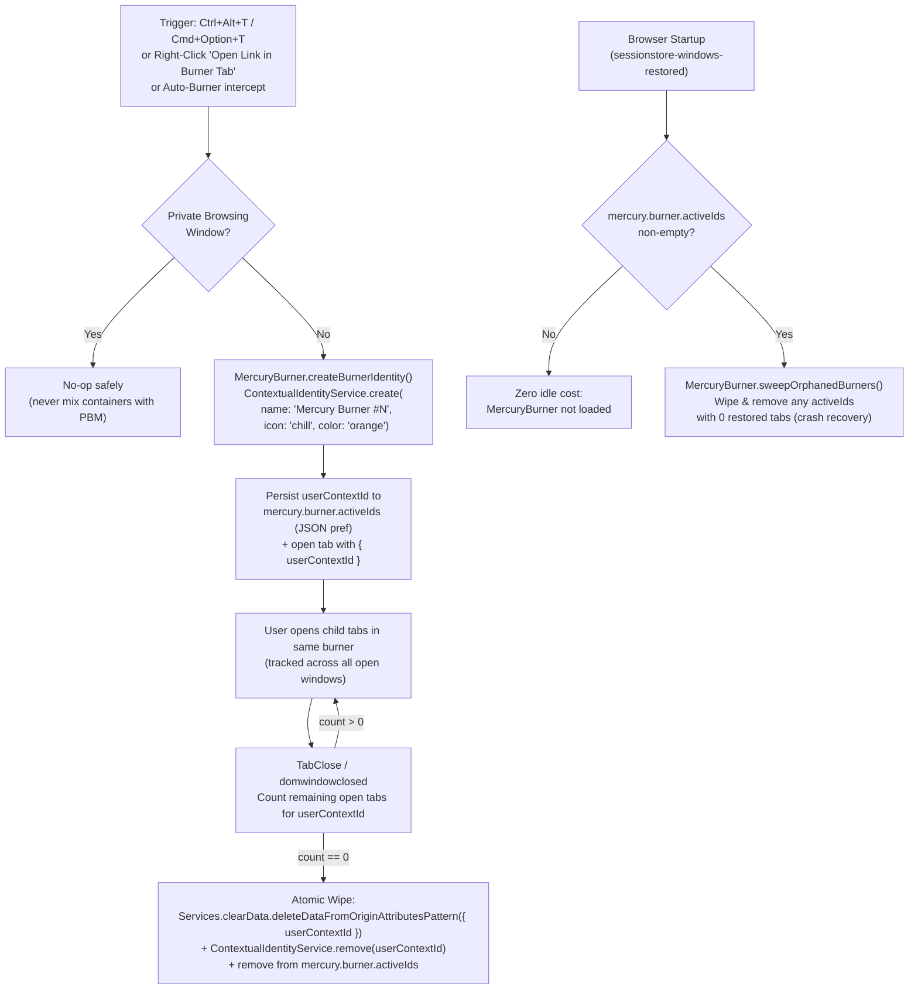

# Mercury Next-Level Privacy, Anti-Fingerprinting & Ephemeral Burner Tabs (Approach A)

**Date:** 2026-11-23  
**Base:** Firefox 160.0.1 (`$HOME/mozilla-unified`)  
**Targets:** Desktop (Linux / Windows / macOS) and Android (GeckoView + Fenix)  
**Status:** Implemented

---

## 1. Goals, Threat Model & Non-Goals

### Goals
1. **Upgraded Crowd-Blend Fingerprinting Protection (FPP):** Close the remaining hardware, WebGL, AudioContext, MediaCapabilities/WebCodecs, window/screen geometry, storage-quota, PDF, and CSS accessibility fingerprinting surfaces in Firefox 160 while preserving high-FPS rendering, native AVX2 JS Math (`-JSMathFdlibm`), system dark/light theme (`-CSSPrefersColorScheme`), and zero breakage on modern web apps.
2. **Deterministic Local Fingerprinting Policy:** Disable Mozilla's RemoteSettings FPP override feed (`privacy.fingerprintingProtection.remoteOverrides.enabled = false`) so remote allowlist/relaxation rules never silently weaken Mercury's fingerprinting posture.
3. **Curated Redirect Query-Parameter Stripping & Anti-Tracking Hardening:** Strip tracking parameters across both direct navigations and HTTP redirect chains (`privacy.query_stripping.redirect = true`) using a curated, zero-breakage 65-parameter ClearURLs/Brave-grade strip list; disable silent third-party Storage Access API auto-grants and headers; and tighten Bounce Tracking Protection grace/purge timers from hours to minutes.
4. **Zero-Background-Chatter Network Silence:** Disable Mozilla's captive-portal and network connectivity probing services by default (`network.captive-portal-service.enabled = false`, `network.connectivity-service.enabled = false`) while exposing an explicit one-click Settings toggle for users on hotel/airport captive-portal Wi-Fi.
5. **Native Ephemeral ("Burner") Tabs:** Provide first-class, one-keystroke (`Ctrl+Alt+T` / `Cmd+Option+T`) and right-click ("Open Link in Burner Tab") disposable tab containers backed by Gecko's `ContextualIdentityService`, with per-container permission isolation (`permissions.isolateBy.userContext = true`), atomic storage/cookie/cache wipe on last-tab close, crash/force-kill orphan recovery, Private Browsing safety guard, and an optional opt-in Auto-Burner mode.

### Non-Goals
- Forcing `privacy.resistFingerprinting = true` (RFP) or Letterboxing in Standard mode (those remain opt-in via Settings > Mercury > Hardened Mode / RFP toggles).
- Stripping functional OAuth, search, pagination, or media query parameters (`id`, `ref`, `v`, `t`, `page`, `q`, `token`, `code`, `state`, `redirect`).
- Modifying core Gecko C++ `nsRFPService` semantics where Firefox 160's `RFPTargets.inc` granular FPP targets already provide clean, zero-maintenance control.

---

## 2. Section 1 — Upgraded Crowd-Blend FPP & RemoteSettings Override Lockout

### Architecture
Firefox 160's `privacy.fingerprintingProtection` engine evaluates a comma-separated list of `+Target` / `-Target` directives from `privacy.fingerprintingProtection.overrides` against the compile-time enum in `toolkit/components/resistfingerprinting/RFPTargets.inc`. Upstream Firefox also downloads dynamic per-site relaxation overrides from Mozilla RemoteSettings (`FingerprintingWebCompatService.sys.mjs`) when `privacy.fingerprintingProtection.remoteOverrides.enabled` is `true`.

Mercury upgrades Crowd-Blend FPP across Desktop (`0003-browser-app-profile-firefox.js.patch`, `MercuryHardened.sys.mjs`) and Android (`0036-android-geckoview-mercury-speed-privacy.patch`) to **36 verified `RFPTargets.inc` targets** and sets `privacy.fingerprintingProtection.remoteOverrides.enabled = false`.

### Canonical `CROWD_BLEND_OVERRIDES` (36 Targets)
```text
+EfficientCanvasRandomization,-CanvasRandomization,+CanvasExtractionFromThirdPartiesIsBlocked,+FontVisibilityLangPack,+ScreenAvailToResolution,+WindowScreenXY,+WindowInnerScreenXY,+ScreenPixelDepth,+MouseEventScreenPoint,+NavigatorHWConcurrencyTiered,+MaxTouchPointsCollapse,+IMEStyle,+WebGLRendererConstant,+WebGLVendorSanitize,+WebGLRandomization,+WebGLRenderCapability,+Gamepad,+DeviceSensors,+AudioSampleRate,+AudioContext,+MediaDevices,+MediaCapabilities,+WebCodecs,+SpeechSynthesis,+NetworkConnection,+DiskStorageLimit,+UseStandinsForNativeColors,+CSSColorInfo,+CSSVideoDynamicRange,+CSSPointerCapabilities,+CSSPrefersReducedTransparency,+CSSInvertedColors,+VideoElementPlaybackQuality,+PdfjsSpoof,-JSMathFdlibm,-CSSPrefersColorScheme
```

### Target Breakdown (15 New Targets Added in Sub-Project 2)
| Category | Newly Added `RFPTargets.inc` Targets | Protection |
| --- | --- | --- |
| **WebGL & Canvas** | `+WebGLRandomization`, `+WebGLRenderCapability`, `+CanvasExtractionFromThirdPartiesIsBlocked` | Randomizes WebGL readback fingerprints, standardizes WebGL capability limits, and blocks silent third-party canvas extraction while keeping first-party GPU rendering fast via `+EfficientCanvasRandomization`. |
| **Audio & Media** | `+AudioContext`, `+MediaCapabilities`, `+WebCodecs` | Defeats AudioContext oscillator/dynamics-compressor fingerprinting and hides hardware codec/decoder capability tables. |
| **Window & Pointer Geometry** | `+WindowScreenXY`, `+WindowInnerScreenXY`, `+ScreenPixelDepth`, `+MouseEventScreenPoint` | Prevents multi-monitor layout leaks, window-position tracking, display bit-depth leakage, and screen-coordinate mouse fingerprinting. |
| **Storage, Colors & CSS** | `+DiskStorageLimit`, `+UseStandinsForNativeColors`, `+CSSPrefersReducedTransparency`, `+CSSInvertedColors`, `+PdfjsSpoof` | Caps `navigator.storage.estimate()` disk-size leakage, replaces OS-specific system colors with standard stand-ins, normalizes rare accessibility CSS media queries, and prevents PDF.js preference probing. |
| **Explicit Exclusions (Retained)** | `-CanvasRandomization`, `-JSMathFdlibm`, `-CSSPrefersColorScheme` | Uses fast sparse SipHash canvas randomization instead of heavy legacy noise, preserves native AVX2 JS Math throughput, and honors user dark/light OS theme. |

---

## 3. Section 2 — Link/Redirect Stripping, Storage Access, Bounce Defense & Network Silence

### 3.1 Curated Redirect Query-Parameter Stripping
- `privacy.query_stripping.enabled = true` (normal windows, existing)
- `privacy.query_stripping.enabled.pbmode = true` (private windows, existing)
- `privacy.query_stripping.strip_on_share.enabled = true` (copy/share links, existing)
- `privacy.query_stripping.redirect = true` (**NEW** — strips tracking parameters during HTTP 301/302/303/307/308 redirect hops, closing bounce-redirector parameter laundering)
- `privacy.query_stripping.strip_list` (**NEW** — 65 space-separated, lowercase, pure tracking parameters):

```text
utm_source utm_medium utm_campaign utm_term utm_content utm_id utm_cid utm_name utm_reader utm_referrer utm_social utm_social-type utm_pubreferrer utm_swu utm_brand utm_channel utm_place gclid gclsrc dclid gbraid wbraid _ga _gl srsltid fbclid igshid igsh fb_action_ids msclkid twclid ttclid rdt_cid li_fat_id sc_cid epik sccid mtm_campaign tw_source tw_campaign mc_cid mc_eid mkt_tok _hsenc _hsmi hsa_acc hsa_cam hsa_grp hsa_ad hsa_src hsa_tgt hsa_kw hsa_mt hsa_net hsa_ver yclid ymclid _openstat __s vero_id vero_conv oly_anon_id oly_enc_id wickedid pk_campaign
```

**Functional Exclusion Guarantee:** Functional OAuth, login, search, pagination, and media parameters (`id`, `ref`, `v`, `t`, `page`, `q`, `token`, `code`, `state`, `redirect`, `return`, `next`, `continue`, `callback`, `scope`, `nonce`) are explicitly excluded and enforced by automated unit tests (`tests/privacy/hardened-unit.mjs`).

### 3.2 Storage Access API Hardening
- `dom.storage_access.auto_grants = false` — disables silent automatic unpartitioned cookie/storage grants for heuristic third-party embeds; sites must go through explicit user permission flow.
- `dom.storage_access.headers.enabled = false` — disables `Sec-Fetch-Storage-Access` / `Activate-Storage-Access` HTTP header negotiation so embedded trackers cannot silently probe or activate unpartitioned storage state over HTTP headers.

### 3.3 Tightened Bounce Tracking Protection
- `privacy.bounceTrackingProtection.mode = 1` (active stateful purge, existing)
- `privacy.bounceTrackingProtection.bounceTrackingGracePeriodSec = 300` (**NEW**, tightened from 3600s to 5 minutes)
- `privacy.bounceTrackingProtection.bounceTrackingPurgeTimerPeriodSec = 600` (**NEW**, tightened from 3600s to 10 minutes)

### 3.4 Zero-Background-Chatter Defaults (with Captive Portal Toggle)
- `network.captive-portal-service.enabled = false` (set in `0003` `browser/app/profile/firefox.js` and Android `0036`)
- `network.connectivity-service.enabled = false` (set in `0027` `modules/libpref/init/all.js` and Android `0036`)
- Eliminates unsolicited periodic background probes to `detectportal.firefox.com` and `firefox-portal-detection.com` on startup and network-change events.
- Users connecting to captive-portal hotel/airport Wi-Fi can flip **Settings > Mercury > Captive Portal Detection (Hotel/Airport Wi-Fi)** (on both Desktop and Android), which toggles both `network.captive-portal-service.enabled` and `network.connectivity-service.enabled` together.

---

## 4. Section 3 — Native Ephemeral ("Burner") Tabs

### Architecture & Lifecycle



### Module & Runtime Contract
- **Module Path:** `resource:///modules/MercuryBurner.sys.mjs` (registered via `EXTRA_JS_MODULES` in `browser/components/mercury/moz.build`), exporting `MercuryBurner` (plus pure testable core).
- **Default Preferences (`0003`):**
  - `privacy.userContext.enabled = true` (enables Gecko contextual identity containers)
  - `permissions.isolateBy.userContext = true` (isolates site permissions such as geolocation/notifications/camera per container so burner permissions never leak into the default container and are wiped on close)
  - `mercury.burner.autoIsolate = false` (opt-in Auto-Burner mode)
  - `mercury.burner.activeIds = "[]"` (JSON array of active burner `userContextId` integers for crash/force-kill orphan recovery)
- **BrowserGlue Hooks (`0024-browser-components-BrowserGlue.sys.mjs.patch`):**
  - Lazy ES module getter: `MercuryBurner: "resource:///modules/MercuryBurner.sys.mjs"`.
  - In `_onFirstWindowLoaded(aWindow)`: registers a lightweight pref observer on `mercury.burner.autoIsolate` (which calls `lazy.MercuryBurner.init()` if toggled on). If `mercury.burner.autoIsolate` is `true` OR `mercury.burner.activeIds !== "[]"`, calls `lazy.MercuryBurner.init()` and `lazy.MercuryBurner.attachWindow(aWindow)`. Otherwise `MercuryBurner` is not loaded at startup (**zero idle cost**).
  - In `_onWindowsRestored()`: if `mercury.burner.activeIds !== "[]"`, calls `lazy.MercuryBurner.sweepOrphanedBurners()` to atomically wipe any burner containers left orphaned by a prior crash or force-kill.
- **UI Entry Points (`0042-mercury-burner-tabs-ui.patch`):**
  - Keyboard shortcut: `Ctrl+Alt+T` (`Cmd+Option+T` on macOS) opens a new Burner Tab in normal windows (ignored/disabled in Private Browsing windows).
  - Link context menu: `"Open Link in Burner Tab"` (`context-openlinkinburner`), wired in `nsContextMenu.sys.mjs` and `browser-context.inc.xhtml` with Fluent l10n strings; automatically hidden in Private Browsing windows.
- **Settings Controls (`mercury.mjs` + `0032` FTL):**
  - **Ephemeral Burner Tabs & Network Silence** group in `about:preferences#mercury`:
    1. **Auto-Burner Mode** (`mercury.burner.autoIsolate`) — intercepts newly opened external/cross-site links into fresh burner containers while never intercepting pinned tabs or internal schemes (`about:`, `chrome:`, `moz-extension:`, `resource:`, `view-source:`).
    2. **Purge All Burner Data Now** — invokes `MercuryBurner.purgeAll()` (and `MercuryHardened.newIdentity()` calls `MercuryBurner.purgeAllUnused()`).
    3. **Captive Portal Detection (Hotel/Airport Wi-Fi)** — toggles `network.captive-portal-service.enabled` and `network.connectivity-service.enabled`.
    4. **Block Silent Storage Access Auto-Grants** — inverted toggle for `dom.storage_access.auto_grants` and `dom.storage_access.headers.enabled`.
    5. **Redirect Query Parameter Stripping** — toggles `privacy.query_stripping.redirect`.

---

## 5. Section 4 — Android Parity & Verification Plan

### Android Parity (`android/**` + `0036-android-geckoview-mercury-speed-privacy.patch`)
Android GeckoView + Fenix mirrors every applicable Section 1 and Section 2 protection with exact parity:
- `geckoview-prefs.js` and `GeckoProvider.kt` set the exact same 36-target `CROWD_BLEND_OVERRIDES`, `privacy.fingerprintingProtection.remoteOverrides.enabled = false`, `privacy.query_stripping.redirect = true`, the exact same 65-parameter `privacy.query_stripping.strip_list`, `dom.storage_access.auto_grants = false`, `dom.storage_access.headers.enabled = false`, `privacy.bounceTrackingProtection.bounceTrackingGracePeriodSec = 300`, `privacy.bounceTrackingProtection.bounceTrackingPurgeTimerPeriodSec = 600`, `network.connectivity-service.enabled = false`, `network.captive-portal-service.enabled = false`, and `permissions.isolateBy.userContext = true`.
- `MercurySettingsFragment.kt` + Android XML resources expose the 3 matching toggles (**Captive Portal Detection**, **Redirect Query Parameter Stripping**, and **Block Silent Storage Access Auto-Grants**).
- Note: Desktop multi-container Burner Tabs rely on Desktop's `ContextualIdentityService` tab strip UI; Android relies on Fenix's native Private Tabs + New Identity full wipe.

### Verification Plan
1. **Patch Integrity:** Sequential `git apply --check` and `git apply` of all `patches/firefox/*.patch` (`0001`–`0042`) against clean Firefox 160.0.1 `HEAD` in an isolated temp repo, leaving `$HOME/mozilla-unified` completely unmodified.
2. **RFP Target & Strip-List Verification (`tests/privacy/hardened-unit.mjs`):**
   - Assert every target in `CROWD_BLEND_OVERRIDES` exists in `$HOME/mozilla-unified/toolkit/components/resistfingerprinting/RFPTargets.inc`.
   - Assert byte-for-byte parity of `CROWD_BLEND_OVERRIDES` across `0003`, `MercuryHardened.sys.mjs`, and Android `0036`.
   - Assert byte-for-byte parity of `privacy.query_stripping.strip_list` across `0003` and `0036`, with zero duplicates and zero functional OAuth/search/nav parameters (`id`, `ref`, `v`, `t`, `page`, `q`, `token`, `code`, `state`, `redirect`).
3. **Burner Tab Unit Tests (`tests/privacy/burner-unit.mjs`):**
   - Container creation & `mercury.burner.activeIds` persistence.
   - Multi-tab reference counting (closing tab 1 of 2 keeps container alive; closing last tab triggers `deleteDataFromOriginAttributesPattern` + `ContextualIdentityService.remove` + pref cleanup).
   - Crash/force-kill orphan sweep (`sweepOrphanedBurners()`).
   - Private Browsing window guard (`openBurnerTab` safely no-ops in private windows).
   - Auto-Burner URL filter (skips pinned tabs and internal `about:`/`chrome:`/`moz-extension:`/`resource:`/`view-source:` schemes).
4. **Syntax, Pref-Audit & Resource Validation:**
   - `node --check` on `MercuryBurner.sys.mjs`, `MercuryHardened.sys.mjs`, `mercury.mjs`, `burner-unit.mjs`, `hardened-unit.mjs`, and patched `BrowserGlue.sys.mjs` / `nsContextMenu.sys.mjs`.
   - Zero duplicate/conflicting prefs across `0003` and `0027`.
   - Zero missing/orphan Fluent l10n IDs (Settings + browser context menu) and valid Android XML via `xml.etree.ElementTree`.
