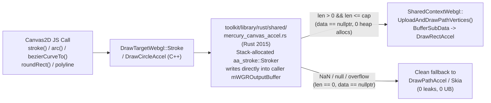

# Mercury Engine, Rendering & Runtime Speed — Rust-First Overhaul (Approach A)

**Date:** 2026-11-24  
**Base:** Firefox 160.0.1 (`$HOME/mozilla-unified`)  
**Targets:** Linux (`x86_64`, `aarch64`), Windows (`x86_64`), macOS, and Android (`arm64-v8a`)  
**Status:** Implemented

---

## 1. Goals, Architecture & Non-Goals

### Goals
1. **Rust-First GPU Canvas2D Geometry Acceleration (`0044`, layered on `0037`):** Move hot Canvas2D stroke tessellation (cubic/quadratic Beziers, stroked circles, 2–64 vertex polylines, and stroked rounded rectangles) into a zero-heap-allocation, memory-safe Rust module (`toolkit/library/rust/shared/mercury_canvas_accel.rs`) built directly on Mozilla's vendored `aa-stroke` crate, eliminating per-draw `Box<Stroker>` heap allocations, C++ `WGR::PathBuilder` churn, and `PathCache` evictions while keeping C++ glue in `DrawTargetWebgl` thin and deduplicated.
2. **Pure-Rust Safe & Fast Native Subsystems:** Enable Mozilla's pure-Rust `fontations` font engine (`--enable-fontations` + `gfx.font_rendering.fontations.enabled = true`) across all release targets and lock pure-Rust SIMD `zlib-rs` (`export USE_LIBZ_RS=1`) in release mozconfigs.
3. **WebAssembly, WebRender & HTTP/3 Runtime Throughput:** Enable Wasm SIMD AVX (`javascript.options.wasm_simd_avx = true` on x86_64), Wasm lazy tiering (`javascript.options.wasm_lazy_tiering = true`), larger WebRender batched texture uploads (`512 KB`), expanded compositor surface pooling (`32`), WebRender layer compositor (`gfx.webrender.layer-compositor = true`), HTTP/3 UDP GSO (`16` segments) + enlarged receive buffers (`4 MB` Desktop / `2 MB` Android), while keeping QUIC 0-RTT disabled (`network.http.http3.enable_0rtt = false`) to preserve replay-attack protection.
4. **Fission Prelaunch & User-Selectable Performance Profiles (`MercuryPerformance.sys.mjs`):** Prelaunch 4 Fission content processes in Balanced mode with low-memory tab unloading active, and expose 3 clean, privacy-preserving Performance & Memory Profiles (`balanced`, `turbo`, `low-ram`) in Settings > Mercury across Desktop and Android.

### Non-Goals
- Enabling HTTP/3 0-RTT early data (`network.http.http3.enable_0rtt` remains `false` on both Desktop and Android to avoid QUIC replay vulnerabilities).
- Enabling x86-only `javascript.options.wasm_simd_avx` on Android ARM64.
- Mutating any privacy, Hardened mode, or Security Level preferences when switching `MercuryPerformance` profiles.
- Modifying `third_party/rust/aa-stroke` vendored sources directly (all Mercury FFI extensions live cleanly in `toolkit/library/rust/shared/mercury_canvas_accel.rs` and reuse `aa_stroke`'s public Rust API).

---

## 2. Section 1 — Rust-First Canvas2D GPU Fast-Paths (`0044`)

### Data Flow & Zero-Heap Architecture

### Rust Module (`toolkit/library/rust/shared/mercury_canvas_accel.rs`)
Registered via `mod mercury_canvas_accel;` in `toolkit/library/rust/shared/lib.rs` (`edition = "2015"`). Exports 4 bounds-checked, zero-heap-allocation `#[no_mangle] pub extern "C"` entry points matching `gfx/src/AAStroke.h` (`AAStroke::VertexBuffer` and `AAStroke::StrokeStyle`) byte-for-byte:

| FFI Function | Input Validation & Behavior | Geometry Tessellated |
| --- | --- | --- |
| `mercury_aa_stroke_cubic_curve` | Validates non-null `style`/`output_ptr`, `output_capacity > 0`, finite `width > 0` / `miter_limit > 0`, all 8 floats finite. | Open cubic Bezier (`move_to(..., false)` + `curve_to_capped`). |
| `mercury_aa_stroke_stroked_circle` | Same style/buffer checks + finite `cx`, `cy`, `radius > 0`. | Closed 4-quadrant cubic Bezier ring with `K = 0.55228475f32 * radius` (`move_to(..., true)` + 4x `curve_to` + `close`). |
| `mercury_aa_stroke_polyline` | Same style/buffer checks + non-null `points_xy`, `2 <= point_count <= 64`, all `point_count * 2` floats finite. | Open or closed polyline (`move_to` + `line_to` / `line_to_capped` + optional `close`). |
| `mercury_aa_stroke_stroked_rounded_rect` | Same style/buffer checks + finite `x`, `y`, `w > 0`, `h > 0`, `rx >= 0`, `ry >= 0`; clamps `rx <= w/2`, `ry <= h/2`. | Closed sharp rectangle (when `rx == 0 || ry == 0`) or 4-corner cubic rounded rectangle with straight connecting edges (`close`). |

**Zero-Heap & Overflow Safety Invariant:** Every entry point constructs `Stroker::new(style_ref)` on the stack and attaches `output_ptr[..output_capacity]` via `stroker.set_output_buffer(slice)`. Because `aa_stroke::PathBuilder` never heap-allocates once an output buffer is attached (tracking required size in `output_buffer_offset`), `finish_into_buffer()` returns `VertexBuffer { data: ptr::null(), len }` ONLY when `len > 0 && len <= output_capacity`. On invalid/NaN/null inputs or capacity overflow, it returns `VertexBuffer { data: ptr::null(), len: 0 }` so C++ cleanly falls back to `DrawPathAccel` with zero heap allocations and zero memory leaks.

### Thin C++ Integration (`gfx/src/AAStroke.h`, `dom/canvas/DrawTargetWebgl.{h,cpp}`)
Layered cleanly on top of `0037-mercury-engine-speed-privacy-overhaul.patch`:
- **`gfx/src/AAStroke.h`**: Declares the 4 `mercury_aa_stroke_*` `extern "C"` prototypes inside `namespace AAStroke`.
- **`SharedContextWebgl::UploadAndDrawPathVertices(...)`**: Unified vertex upload, ring-buffer wraparound/reset, `BufferSubData` (`unsynchronized = true`), and `DrawRectAccel` dispatch helper shared by all 5 fast paths (filled circle, stroked circle, cubic/quad curve, polyline, rounded rect).
- **`SharedContextWebgl::DrawCircleAccel`**: Retains the filled-circle fast path from `0037` and adds the stroked-circle fast path calling `AAStroke::mercury_aa_stroke_stroked_circle` when `aStrokeOptions != nullptr` and `SupportsAAStroke(..., false) == AAStrokeMode::Geometry`.
- **`SharedContextWebgl::StrokeCurveAccel`**: Upgraded from multi-FFI `aa_stroke_new`/`release` (heap-allocated `Box<Stroker>`) to single-call zero-heap `AAStroke::mercury_aa_stroke_cubic_curve`.
- **`SharedContextWebgl::StrokePolylineAccel` & `SharedContextWebgl::StrokeRoundedRectAccel`**: Wired into `DrawTargetWebgl::Stroke` for `SkPath::isRRect` (`rrect.isSimple()`) and `kMove` + `2..64` `kLine` (+ optional `kClose`) polylines.

---

## 3. Section 2 — Pure-Rust Fontations, `zlib-rs`, Wasm, WebRender & HTTP/3 Tuning

### Compile-Time Rust Subsystems (`mozconfigs/**`)
- `ac_add_options --enable-fontations` enabled across all supported release mozconfigs (Linux, Windows, macOS, Android) to compile Mozilla's memory-safe pure-Rust OpenType/TrueType font parser and rasterizer (`fontations_glue`).
- `export USE_LIBZ_RS=1` locked across release mozconfigs to enforce pure-Rust SIMD-accelerated `zlib-rs` (`libz-rs-sys`) for HTTP/PNG/omni.ja decompression.

### Runtime Preferences (`0003` Desktop & `0036` Android)
| Preference | Desktop (`0003`) | Android (`0036`) | Purpose |
| --- | --- | --- | --- |
| `gfx.font_rendering.fontations.enabled` | `true` | `true` | Activates pure-Rust Fontations font backend by default (toggleable in Settings > Mercury). |
| `javascript.options.wasm_simd_avx` | `true` (`XP_WIN \|\| XP_LINUX`) | *(omitted — ARM64)* | Enables AVX codegen for Wasm 128-bit SIMD on x86_64. |
| `javascript.options.wasm_lazy_tiering` | `true` | `true` | Compiles Wasm functions lazily to Ion for faster module startup and lower memory overhead. |
| `gfx.webrender.batched-upload-threshold` | `524288` (512 KB) | `524288` (512 KB) | Batches small texture uploads to reduce GPU driver call overhead. |
| `gfx.webrender.compositor.surface-pool-size` | `32` | `32` | Larger native compositor surface pool reduces tile reallocations during fast scrolling/animations. |
| `gfx.webrender.layer-compositor` | `true` | `true` | Enables WebRender's optimized layer compositor path. |
| `network.http.http3.max_gso_segments` | `16` | `16` | Coalesces up to 16 QUIC UDP datagrams per `sendmsg` syscall via UDP GSO. |
| `network.http.http3.recvBufferSize` | `4194304` (4 MB) | `2097152` (2 MB) | Larger QUIC socket receive buffer avoids packet drops on gigabit/5G links. |
| `network.http.http3.enable_0rtt` | `false` | `false` | Keeps QUIC 0-RTT disabled to prevent replay attacks on both Desktop and Android. |
| `dom.ipc.processPrelaunch.fission.number` | `4` | *(Android manages per-profile)* | Keeps 4 warm preallocated Fission content processes ready for instant navigation. |
| `browser.tabs.unloadOnLowMemory` | `true` | *(Android native OOM)* | Unloads idle background tabs automatically under memory pressure (toggleable in Settings). |
| `mercury.performance.profile` | `"balanced"` | `"balanced"` | Active `MercuryPerformance` profile (`balanced` / `turbo` / `low-ram`). |

---

## 4. Section 3 — `MercuryPerformance.sys.mjs`, Settings UI & Android Parity

### Desktop Performance Profiles (`browser/components/mercury/MercuryPerformance.sys.mjs`)
Registered as `resource:///modules/MercuryPerformance.sys.mjs` in `browser/components/mercury/moz.build`. Switching profiles mutates ONLY performance/memory prefs (never touching privacy, Hardened mode, or Security Level settings):

| Preference | `balanced` (default) | `turbo` (High-RAM) | `low-ram` (Constrained) |
| --- | --- | --- | --- |
| `dom.ipc.processPrelaunch.fission.number` | `4` | `6` | `1` |
| `gfx.canvas.accelerated.cache-size` | `512` | `1024` | `128` |
| `javascript.options.mem.nursery.max_kb` | `65536` | `131072` | `16384` |
| `image.mem.surfacecache.max_size_kb` | `2097152` | `2097152` | `262144` |
| `content.notify.interval` | `100000` | `83333` | `120000` |
| `browser.tabs.unloadOnLowMemory` | `true` | `false` | `true` |

### Settings Controls
- **Desktop (`mercury.mjs` + `0032` FTL):** Performance & Memory Profile selector (`balanced` / `turbo` / `low-ram`), Rust Fontations Font Engine toggle (`gfx.font_rendering.fontations.enabled`), and Auto-Unload Idle Tabs on Low Memory toggle (`browser.tabs.unloadOnLowMemory`).
- **Android (`MercurySettingsFragment.kt` + `android/res/` + `0036`):** Performance & Memory Profile `ListPreference` (`balanced` / `turbo` / `low-ram` with mobile-tuned cache/nursery/notify values) and Rust Fontations Font Engine `SwitchPreference`.

---

## 5. Verification Plan

1. **Sequential Patch Application:** Apply all **43/43** `patches/firefox/*.patch` (`0001`–`0044`, specifically testing `0037` -> `0044` ordering) cleanly against Firefox 160.0.1 `HEAD` in an isolated temp repo without modifying `$HOME/mozilla-unified`.
2. **Rust 2015 Compilation & Unit Tests:** Compile vendored `third_party/rust/aa-stroke` + `euclid` + `num-traits` and execute `rustc --edition=2015 --test toolkit/library/rust/shared/mercury_canvas_accel.rs`, plus verify submodule compilation (`extern crate aa_stroke; mod mercury_canvas_accel;`) in Rust 2015. All tests assert valid non-zero vertex emission into caller's stack buffer (`data == null`, `len <= cap`, all vertices finite), exact clamping on rounded rects, and zero-leak fallback (`data == null`, `len == 0`) on NaN/Inf/null/overflow/bad-point-count inputs.
3. **C++/Rust ABI & Signature Audit:** Verify `AAStroke.h` prototypes match `mercury_canvas_accel.rs` `#[repr(C)]` types byte-for-byte and `DrawTargetWebgl.{h,cpp}` calls match Firefox 160 signatures cleanly.
4. **JS Unit Tests, Static Checks & Android XML:** Run `node tests/privacy/{hardened,burner,security,performance}-unit.mjs`, `node --check`, `./scripts/bench-verify.sh --static` (`--enable-fontations`, `USE_LIBZ_RS=1`, hardening flags, mozconfigs), Fluent l10n coverage, and Android XML validation.
