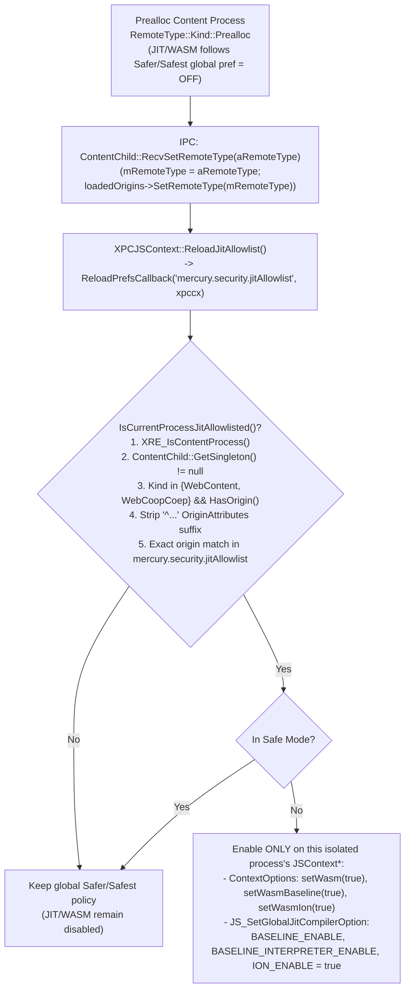

# Mercury Hardcore Security & Exploit Mitigations (Approach A)

**Date:** 2026-11-24  
**Base:** Firefox 160.0.1 (`$HOME/mozilla-unified`)  
**Targets:** Linux (`x86_64`, `aarch64`), Windows (`x86_64`), macOS, and Android (`arm64-v8a`)  
**Status:** Implemented

---

## 1. Goals, Threat Model & Non-Goals

### Goals
1. **Zero-Regression Compiler & Binary Exploit Mitigations:** Harden release binaries with Clang's dynamic object-size fortification (`_FORTIFY_SOURCE=3`) and hardware Control-Flow Integrity — Intel CET Indirect Branch Tracking (`-fcf-protection=branch`) on Linux `x86_64`, and ARMv8.3 Pointer Authentication + ARMv8.5 Branch Target Identification (`-mbranch-protection=standard`) on Linux and Android `arm64` — without breaking debug builds or Windows MSVC/clang-cl toolchains.
2. **Process-Boundary, Sandbox & Transport Hardening:** Disable JIT compilation in the privileged parent process (`javascript.options.main_process_disable_jit = true`), enforce W^X JIT code-page protection in content processes (`javascript.options.content_process_write_protect_code = true`), enforce Fission `IsolateEverything` (`fission.webContentIsolationStrategy = 1`) across Desktop and Android, lock down Windows CET User Shadow Stack / ACG / pre-spawn CIG / Win32k lockdown / KsecDD handle closure and Linux seccomp-bpf level 6 + socket level 2 + GPU sandbox, and harden TLS/mixed-content/CSP-reporting/download handling.
3. **Vanadium-Style Per-Site JIT & WebAssembly Allowlisting (`0043`):** Allow users running Mercury in **Safer** or **Safest** security levels (where global SpiderMonkey JIT and/or WebAssembly are disabled to eliminate the largest browser RCE attack surface) to selectively re-enable JIT + WebAssembly for explicitly trusted, Fission-isolated sites (e.g., `https://figma.com`, `https://meet.jit.si`) without weakening any other origin or any privileged/shared process.

### Threat Model
- **Drive-by Renderer RCE (JIT/WASM):** Modern browser exploits overwhelmingly abuse SpiderMonkey/V8 optimizing JITs (Ion/Warp, Wasm) in untrusted renderer processes. Per-site JIT/WASM allowlisting paired with Fission `IsolateEverything` ensures each allowlisted origin executes in its own isolated OS process while all untrusted web origins stay interpreter-only in Safer/Safest mode.
- **Sandbox Escape & ROP/JOP Chains:** Enforcing hardware shadow stacks (Windows CET), IBT (`-fcf-protection=branch`), ARM PAC+BTI (`-mbranch-protection=standard`), Win32k syscall lockdown, ACG, pre-spawn CIG, W^X JIT pages, and Linux seccomp-bpf level 6 eliminates whole classes of memory-corruption and kernel-attack-surface escapes.
- **Origin Confusion & Prealloc Races:** A preallocated content process starts with `RemoteType::Kind::Prealloc` before being specialized via IPC (`ContentChild::RecvSetRemoteType`). Per-site allowlisting must never enable JIT on `prealloc`, shared `web`, `extension`, `privilegedabout`, `privilegedmozilla`, or `file` processes, and must re-evaluate cleanly right as `mRemoteType` transitions from `Prealloc` to an isolated web origin before web scripts execute.

### Non-Goals
- Enabling global JIT in the privileged parent process (the parent process runs browser chrome/UI and stays interpreter-only when `javascript.options.main_process_disable_jit = true`).
- Supporting wildcards (`*.example.com`), path prefixes, or substring matching in `mercury.security.jitAllowlist` (strict exact origin matching eliminates subdomain takeover and suffix-spoofing attacks).
- Applying GNU-only flags (`-fcf-protection=branch`, `-D_FORTIFY_SOURCE=3`) to Windows MSVC/clang-cl or Android Bionic builds where those flags are unsupported or incompatible.

---

## 2. Section 1 — Compiler & Binary Exploit Mitigations

| Platform | Mozconfigs | Compiler Mitigations | Notes |
| --- | --- | --- | --- |
| **Linux `x86_64`** | `mozconfig-avx2`, `mozconfig`, `mozconfig-sse3`, `mozconfig-sse4` | `-U_FORTIFY_SOURCE -D_FORTIFY_SOURCE=3 -fcf-protection=branch` in `CFLAGS`/`CPPFLAGS`/`CXXFLAGS` (all optimizing modes `-O2`/`-O3`, never `-O0`) | `_FORTIFY_SOURCE=3` uses Clang `__builtin_dynamic_object_size` for dynamic buffer bounds checks; `-fcf-protection=branch` emits Intel CET `ENDBR64` landing pads (no-ops on pre-CET CPUs, hardware IBT enforcement on CET CPUs). Overrides any earlier `-D_FORTIFY_SOURCE=2` from `--enable-hardening`. |
| **Linux `aarch64`** | `mozconfig-arm64` | `-U_FORTIFY_SOURCE -D_FORTIFY_SOURCE=3 -mbranch-protection=standard` | Enables ARMv8.3 PAC (return address signing) + ARMv8.5 BTI (indirect branch target enforcement) in NOP space (backward-compatible with ARMv8.0–v8.2 CPUs). |
| **Android `arm64-v8a`** | `mozconfig-android-arm64` | `-mbranch-protection=standard` | Hardware PAC+BTI for Android ARM64; omits `-D_FORTIFY_SOURCE=3` because Android Bionic headers cap fortification at level 2. |
| **Windows `x86_64`** | `mozconfig-win*` | Firefox native `/CETCOMPAT` + runtime CET/ACG/CIG/Win32k sandbox prefs | Explicitly verified to carry **zero** GNU-only `-fcf-protection=branch` or `-D_FORTIFY_SOURCE=3` flags. |
| **Debug builds** | `mozconfig-debug`, `mozconfig-win-debug` | Unmodified | Never add `-D_FORTIFY_SOURCE=3` on `-O0` debug builds. |

---

## 3. Section 2 — OS Sandbox, Fission & Strict Transport Hardening

All defaults are verified directly against Firefox 160.0.1 `modules/libpref/init/StaticPrefList.yaml`, `browser/app/profile/firefox.js`, and `modules/libpref/init/all.js`:

### 3.1 Process & JIT Boundary Isolation (`0003` + Android `0036`)
- `javascript.options.main_process_disable_jit = true` — disables JIT code generation in the privileged parent process.
- `javascript.options.content_process_write_protect_code = true` — enforces strict W^X memory protection on JIT code pages in content processes (`XPCJSContext.cpp:993`, `StaticPrefList.yaml:10529`).
- `fission.autostart = true` & `fission.webContentIsolationStrategy = 1` (`IsolateEverything`) — isolates every web origin into its own content process (replacing Firefox's default `IsolateHighValue` strategy `2`), which is both a standalone Spectre/UXSS barrier and the prerequisite for per-site JIT/WASM allowlisting.
- `mercury.security.jitAllowlist = ""` — empty by default; comma-separated list of exact trusted origins (`scheme://host[:port]`).

### 3.2 Windows Process Sandbox & Exploit Mitigations (`0003` `#ifdef XP_WIN`)
- Win32k lockdown: `security.sandbox.content.win32k-disable = true`, `security.sandbox.gmp.win32k-disable = true`, `security.sandbox.socket.win32k-disable = true`.
- Hardware CET User Shadow Stack: `security.sandbox.content.shadow-stack.enabled = true` (upgraded from upstream `false`), plus `gpu`, `rdd`, `socket`, and `gmp` shadow-stack enabled (`true`).
- Arbitrary Code Guard (ACG): `security.sandbox.rdd.acg.enabled = true`, `security.sandbox.gmp.acg.enabled = true`, `security.sandbox.utility-wmf.acg.enabled = true`.
- Code Integrity Guard & handle hardening: `security.sandbox.cig.prespawn.enabled = true` (upgraded from Nightly-only), `security.sandbox.content.close-ksecdd-handle = true`.

### 3.3 Linux Process Sandbox (`0003` `#ifdef XP_LINUX`)
- `security.sandbox.content.level = 6` (full seccomp-bpf + file broker + network/display isolation + default-deny `ioctl`).
- `security.sandbox.socket.process.level = 2` (socket sandbox + default-deny `ioctl`).
- `security.sandbox.gpu.level = 1` (enables GPU sandbox level when supported).
- `security.sandbox.warn_unprivileged_namespaces = true` (surfaces warning if host kernel disables unprivileged user namespaces).

### 3.4 Strict Transport, Mixed Content & Download Safety (`0003` + Android `0036`)
- `security.tls.version.min = 3` (TLS 1.2 minimum; legacy TLS 1.0/1.1 permanently rejected).
- `security.ssl.require_safe_negotiation = true` (rejects servers vulnerable to RFC 5746 renegotiation MitM).
- `dom.security.https_only_mode_send_http_background_request = false` (eliminates cleartext HTTP background probe while HTTPS-Only Mode upgrades a navigation).
- `security.mixed_content.block_display_content = true` (blocks passive HTTP mixed-content subresources that cannot be upgraded to HTTPS).
- `security.csp.reporting.enabled = false` (prevents CSP violation report beacons from leaking browsing metadata to third-party report collectors).
- `security.dialog_enable_delay = 1000` (1-second anti-clickjacking activation delay on security dialogs).
- `browser.download.always_ask_before_handling_new_types = true` (Desktop `0003`: always prompts before opening newly encountered file types).
- `network.auth.subresource-http-auth-allow = 1` (blocks cross-origin subresource HTTP auth credential phishing prompts; retained single definition in `0003`).

---

## 4. Section 3 — Vanadium-Style Per-Site JIT & WebAssembly Allowlisting (`0043`)

### Architecture & Process Lifecycle

### Surgical C++ Implementation (`patches/firefox/0043-mercury-per-site-jit-allowlist.patch`)
1. **`js/xpconnect/src/xpcprivate.h`**:
   - Declares `static void ReloadJitAllowlist();` on `class XPCJSContext`.
2. **`js/xpconnect/src/XPCJSContext.cpp`**:
   - **`NormalizeMercuryJitOrigin(const nsACString& aInput, nsACString& aOut)`**:
     - Trims ASCII whitespace (`' '`, `'\t'`, `'\r'`, `'\n'`), lowercases ASCII characters, accepts `https://host[:port]`, `http://host[:port]`, or bare `host[:port]` (normalized to `https://host[:port]`), strips at most one trailing `/` on a bare root origin, and rejects empty inputs, wildcards (`*`), paths/queries/fragments (`/`/`?`/`#`), userinfo (`@`), OriginAttributes (`^`), non-`http(s)` schemes (`javascript:`, `file:`, `about:`, `data:`), invalid hostname characters, and out-of-range ports (`< 1` or `> 65535`).
   - **`IsCurrentProcessJitAllowlisted()`**:
     - Strictly returns `false` unless `XRE_IsContentProcess()` is true, `ContentChild::GetSingleton()` is non-null, and `cc->GetRemoteType()` has `HasOrigin()` AND `GetKind()` is `RemoteType::Kind::WebContent` (`webIsolated=<origin>`) or `RemoteType::Kind::WebCoopCoep` (`webCOOP+COEP=<origin>`). Explicitly rejects `Prealloc`, shared `WebContent` without origin, `Extension`, `PrivilegedAbout`, `PrivilegedMozilla`, `File`, `Inference`, `NotRemote`, and `Unknown`.
     - Copies `remoteType.OriginNoSuffix()`, defensively truncates at any `^` OriginAttributes separator (e.g., `https://figma.com^userContextId=1` -> `https://figma.com`), normalizes it, reads `mercury.security.jitAllowlist`, splits on `,`, normalizes each token, and requires **exact** origin equality (`candidate.Equals(processOrigin)`).
   - **`xpc::SetPrefableContextOptions(JS::ContextOptions& options)`**:
     - When `IsCurrentProcessJitAllowlisted()` is true, forces `options.setWasm(true).setWasmBaseline(true).setWasmIon(true)` so both main-thread JS and Web Workers inside the allowlisted isolated process receive WebAssembly support.
   - **`ReloadPrefsCallback(const char* pref, void* aXpccx)`**:
     - After Safe Mode handling, if `!safeMode && IsCurrentProcessJitAllowlisted()`, forces `ContextOptions` (`setWasm(true)`, `setWasmBaseline(true)`, `setWasmIon(true)`) and `JS_SetGlobalJitCompilerOption` (`JSJITCOMPILER_BASELINE_ENABLE`, `JSJITCOMPILER_BASELINE_INTERPRETER_ENABLE`, `JSJITCOMPILER_ION_ENABLE` = `true`) on `xpccx->Context()` only.
   - **`XPCJSContext::ReloadJitAllowlist()`**:
     - Safely checks `XPCJSContext::Get()` and invokes `ReloadPrefsCallback("mercury.security.jitAllowlist", xpccx)`.
   - **Pref Lifecycle:** Registers `ReloadPrefsCallback` on `"mercury.security.jitAllowlist"` in `XPCJSContext::Initialize()` and unregisters it in `XPCJSContext::~XPCJSContext()` (preventing dangling pointer callbacks at shutdown).
3. **`dom/ipc/ContentChild.cpp`**:
   - Includes `"xpcprivate.h"` (already accessible via `dom/ipc/moz.build` `LOCAL_INCLUDES += ["/js/xpconnect/src"]`, used by `ProcessHangMonitor.cpp` and `JSActor.cpp`).
   - Invokes `XPCJSContext::ReloadJitAllowlist();` inside `ContentChild::RecvSetRemoteType()` immediately after `mRemoteType` and `loadedOrigins->SetRemoteType(mRemoteType)` are updated, ensuring preallocated processes apply the site-specific JIT/WASM policy before any web script executes.

### Security Invariants & Edge Cases
- **Suffix / Subdomain Spoofing:** `https://evil-figma.com` and `https://figma.com.evil.com` never match `https://figma.com`; `https://figma.com:8443` never matches `https://figma.com` (exact `scheme://host[:port]` equality).
- **Container / Burner Tab Compatibility:** A Burner Tab or Multi-Account Container for `https://figma.com` produces OriginAttributes (`^userContextId=N`). Stripping the `^...` suffix allows the user's explicit `https://figma.com` allowlist entry to work inside isolated containers while keeping the process strictly isolated to that container + origin.
- **Safe Mode Precedence:** Troubleshooting / Safe Mode always disables JIT and WasmBaseline even for allowlisted origins.
- **Runtime Pref Changes:** Modifying `mercury.security.jitAllowlist` in Settings fires `ReloadPrefsCallback` immediately in active content processes (and newly navigated/reloaded isolated tabs receive the updated policy).

---

## 5. Section 4 — Desktop & Android Parity + Verification Plan

### Desktop & Android Settings Controls
Both Desktop (`browser/components/preferences/config/mercury.mjs` + `0032` FTL, backed by `MercuryHardened.sys.mjs` helpers matching `0043`'s exact normalization rules) and Android (`MercurySettingsFragment.kt` + Android XML + `0036`) expose:
1. **Trusted JIT & WebAssembly Sites** (`mercury.security.jitAllowlist`) — text input normalizing comma-separated origins to canonical `scheme://host[:port]` entries.
2. **Parent-Process JIT Killswitch** (`javascript.options.main_process_disable_jit`, default `true`).
3. **Strict Fission Site Isolation** (`fission.webContentIsolationStrategy`, mapped `true` -> `1` IsolateEverything, `false` -> `2` IsolateHighValue, default `true`).

### Verification Plan
1. **Sequential Patch Application:** Apply all `patches/firefox/*.patch` (`0001`–`0043`) in exact glob order against clean Firefox 160.0.1 `HEAD` in an isolated temp repo without modifying `$HOME/mozilla-unified`.
2. **C++ Header & API Verification (`0043`):** Verify every header include, `LOCAL_INCLUDES` entry in `js/xpconnect/src/moz.build` and `dom/ipc/moz.build`, `RemoteType` / `ContentChild` / `XPCJSContext` / `JS_SetGlobalJitCompilerOption` / `JS::ContextOptions` signature, `XRE_IsContentProcess()` + `WebContent`/`WebCoopCoep` + `HasOrigin()` guard, `^` OriginAttributes stripping, exact origin matching, and `RecvSetRemoteType()` hook against Firefox 160.0.1 `HEAD`.
3. **Pref & Compiler Flag Audit:**
   - Assert every new pref in `0003` and `0036` exists in Firefox 160 `StaticPrefList.yaml` / `firefox.js` / `all.js` (0 typos, 0 non-ifdef duplicates).
   - Run `./scripts/bench-verify.sh --static` confirming `-fcf-protection=branch` and `-D_FORTIFY_SOURCE=3` on Linux `x86_64` release mozconfigs, `-mbranch-protection=standard` on ARM64 release mozconfigs, clean Windows/debug exclusion, and local Clang acceptance test.
4. **Automated Unit Tests:**
   - `node tests/privacy/hardened-unit.mjs`
   - `node tests/privacy/burner-unit.mjs`
   - `node tests/privacy/security-unit.mjs` (normalization, OriginAttributes stripping, suffix/port/wildcard/scheme/path spoofing rejection, pref validation, `0043` C++ markers, Fluent l10n coverage).
